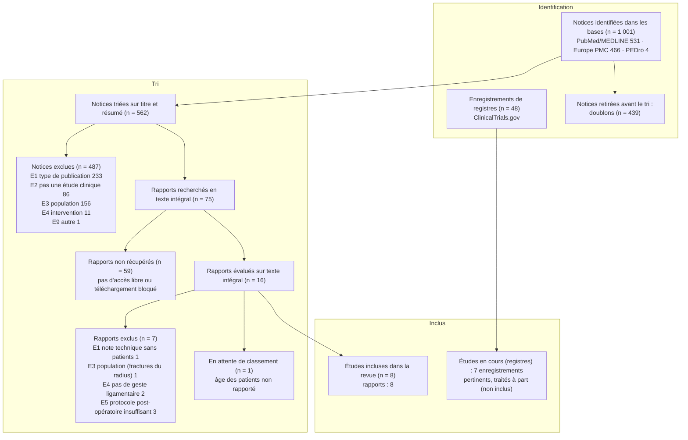

# Diagramme de flux PRISMA 2020 (final)

> Nombres issus de `sr-screener` (`../phase2/tri/Screening_TA/TA_prisma_counts.json` et `../phase2/tri/Screening_FT/FT_prisma_counts.json`), arrêtés au 2026-10-11.
> Si l'auteur modifie une décision de tri (question R00527, voir `../phase2/extraction/extraction_reconciliee_et_risque_biais.md`, section 7), ce diagramme sera mis à jour.

## Remarques à reporter dans les Méthodes et la Discussion

1. **Bases non interrogées** : Embase, Scopus, Web of Science, CINAHL et Cochrane CENTRAL (pas d'accès).
2. **Textes non récupérés** : 59 sur 75 (79 %). C'est la principale limite de la revue.
   - Seuls les textes en accès libre ont pu être lus (biais d'accès libre).
   - Deux des trois études témoins (Kemler 2023, Ying 2024) en font partie.
3. **Sélection par IA sans vérification humaine** (voir `../phase2/declaration_tri_IA.md`).
4. **Recoupement de populations** : S1 (Bakker 2022) et S2 (Dullemans 2024) viennent de la même base de données néerlandaise. Elles sont comptées comme deux études, mais leurs patients ne sont pas additionnés.
5. **Registres** : les 48 enregistrements de ClinicalTrials.gov ont été examinés par un seul relecteur IA, en dehors de `sr-screener`. Sept concernent directement le sujet, dont **NCT06590701**, un essai en cours qui compare le mouvement de lancer de fléchette précoce à une mobilisation dans les plans anatomiques après reconstruction SL. Aucun n'a de résultats publiés à cette date.
