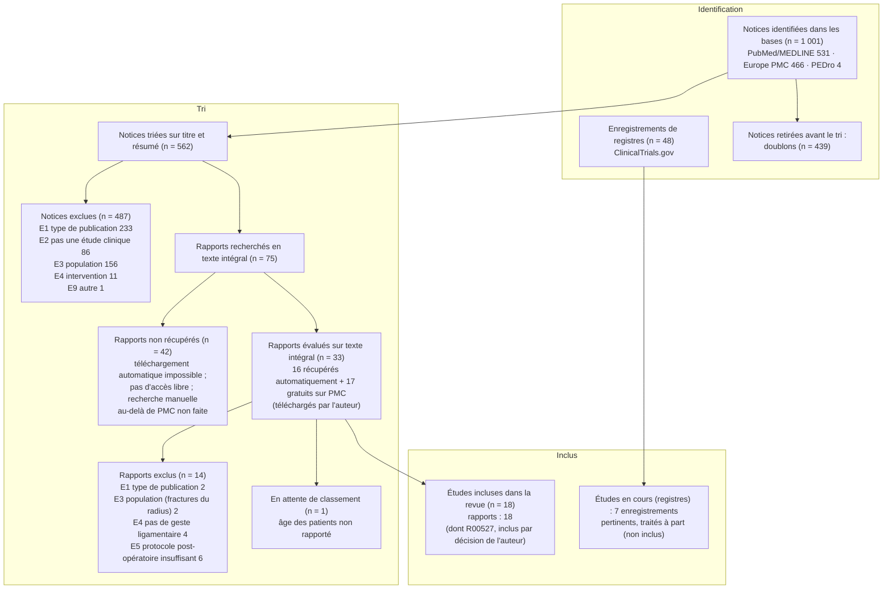

# Diagramme de flux PRISMA 2020 (final)

> Nombres issus de `sr-screener` (`../phase2/tri/Screening_TA/TA_prisma_counts.json` et `../phase2/tri/Screening_FT/FT_prisma_counts.json`).
> **Mise à jour du 2026-10-25 :** les 17 textes gratuits sur PMC envoyés par l'auteur ont été triés sur texte intégral (révision 2 du tri, 2026-10-24) : 9 inclus, 8 exclus. R00527 reste inclus par décision de l'auteur (2026-10-19).

## Remarques à reporter dans les Méthodes et la Discussion

1. **Bases non interrogées** : Embase, Scopus, Web of Science, CINAHL et Cochrane CENTRAL (pas d'accès).
2. **Textes non récupérés** : 42 sur 75 (56 %). C'est la principale limite de la revue.
   - **Cause :** les éditeurs et PMC bloquent le téléchargement automatique, et les articles restants ne sont pas en accès libre. L'auteur a téléchargé à la main les 17 textes gratuits sur PMC. Aucune autre source (bibliothèque, demande aux auteurs) n'a fourni de texte à cette date.
   - Parmi les rapports non lus figure encore une des trois études témoins : Ying 2024 (R00090, rééducation « accélérée » après greffe de long palmaire arthroscopique), non gratuit sur PMC et non reçu.
   - Les textes lus restent donc ceux qui sont en accès libre (biais d'accès).
3. **Accord entre relecteurs IA** sur texte intégral (33 rapports) : 93,9 % ; kappa 0,879 ; 1 désaccord arbitré par un troisième relecteur IA, 1 décision de l'auteur (R00527).
   - Exclusions du second tri (8) : E1 revue narrative 1 (R00500) ; E3 réparation SL pendant une ostéosynthèse du radius 1 (R00528) ; E4 pas de geste ligamentaire 3 (débridement seul R00294, rétraction thermique R00366, comparaison radiologique R00070) ; E5 protocole insuffisant 3 (R00171, R00232, R00257).
   - **Correction :** le message du commit `0beeb60` (2026-10-24) indique « 7 inclus, 10 exclus » ; les nombres corrects sont **9 inclus, 8 exclus** (fichiers `sr-screener`).
4. **Sélection par IA sans vérification humaine** (voir `../phase2/declaration_tri_IA.md`).
5. **Recoupement de populations** : S1 (Bakker 2022) et S2 (Dullemans 2024) viennent de la même base de données néerlandaise. Elles sont comptées comme deux études, mais leurs patients ne sont pas additionnés. S13 (Chung 2025) et S17 (Carratalá 2020) viennent de la même équipe espagnole, sur des périodes distinctes : pas de recoupement.
6. **Autres méthodes** : la recherche par citations (en amont et en aval) prévue au protocole **n'a pas été faite**. Le diagramme n'a donc pas de branche « autres méthodes ».
7. **Registres** : les 48 enregistrements de ClinicalTrials.gov ont été examinés par un seul relecteur IA, en dehors de `sr-screener`. Sept concernent directement le sujet, dont **NCT06590701**, un essai en cours qui compare le mouvement de lancer de fléchette précoce à une mobilisation dans les plans anatomiques après reconstruction SL. Aucun n'a de résultats publiés à cette date.
